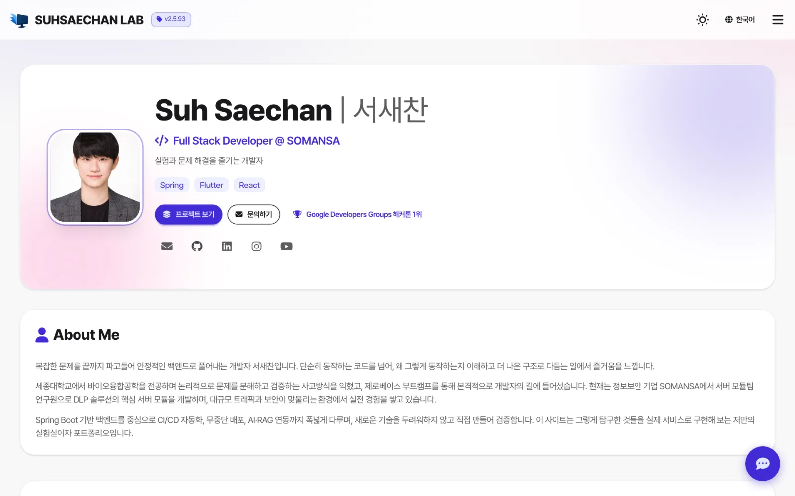
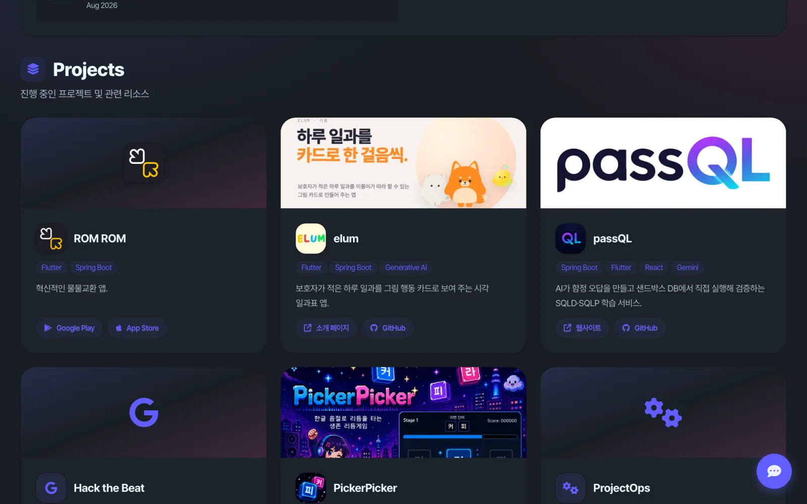

# SUHSAECHAN LAB

> Saechan Suh's portfolio and dev lab — the projects I ship, the tools I use daily, and the self-hosted server behind them.

[](https://lab.suhsaechan.kr/)
[](https://github.com/Cassiiopeia)

<!-- 수정하지마세요 자동으로 동기화 됩니다 -->
<!-- AUTO-VERSION-SECTION: DO NOT EDIT MANUALLY -->
## Version: v2.5.113 (2026-10-27)

[View Changelog (Korean)](CHANGELOG.md)

---

<p align="center">
  
  
</p>

---

## What is this?

**[lab.suhsaechan.kr](https://lab.suhsaechan.kr)** is one Spring Boot app that does two jobs.

- **Public portfolio**: profile, awards, project cards with live links, timeline, certifications and tech stack. Light and dark themes, Korean and English.
- **Private lab**: the internal tools I use to run my own server and projects. These pages sit behind a login.

## Public pages

| Page | What it does |
|------|-------------|
| [Dashboard](https://lab.suhsaechan.kr/dashboard) | Portfolio: projects, awards, timeline, tech stack |
| [Issue Helper](https://lab.suhsaechan.kr/issue-helper) | Branch names and commit messages from a GitHub issue URL |
| [Translator](https://lab.suhsaechan.kr/translator) | AI translation with language auto-detect |
| [Sejong Auth](https://lab.suhsaechan.kr/sejong-auth) | Demo of [SUH-sejong-univ-auth](https://github.com/Cassiiopeia/SUH-sejong-univ-auth), Sejong University portal login |
| [SUH Random](https://lab.suhsaechan.kr/suh-random) | Demo of [suh-random-engine](https://github.com/Cassiiopeia/suh-random-engine), nickname generator |
| [DevOps Template](https://lab.suhsaechan.kr/suh-devops-template) | Intro to [ProjectOps](https://github.com/Cassiiopeia/projectops), the issue-to-deploy automation template |

Private tools (login required) include Docker container logs, AI server control, a task tracker, a chatbot and notice management.

## Tech stack

```
Backend    Spring Boot 3.4 · Java 17 · multi-module Gradle (domain modules + web)
Database   PostgreSQL (Flyway) · Redis
Frontend   Thymeleaf · Tailwind CSS v4 + DaisyUI 5 (build-time static CSS)
Deploy     Docker · GitHub Actions blue-green deploy · Synology NAS · Cloudflare
SEO        Open Graph · JSON-LD · sitemap.xml · robots.txt · IndexNow
```

## Run locally

```bash
cd Suh-Web/frontend && npm install && npm run build:css && cd ../..
./gradlew bootRun --args='--spring.profiles.active=dev'
```

You need PostgreSQL, Redis and an `application.yml` with your own settings. The file is not in the repo because it holds secrets.

---

## About me

**Saechan Suh** (서새찬). Server Module Team @ SOMANSA. Sejong University.

- [Live site](https://lab.suhsaechan.kr) · [Email](mailto:chan4760@gmail.com) · [GitHub](https://github.com/Cassiiopeia) · [LinkedIn](https://www.linkedin.com/in/suh-saechan-b0b1b8339/)

## License

[MIT](LICENSE) © 2025 Saechan Suh
