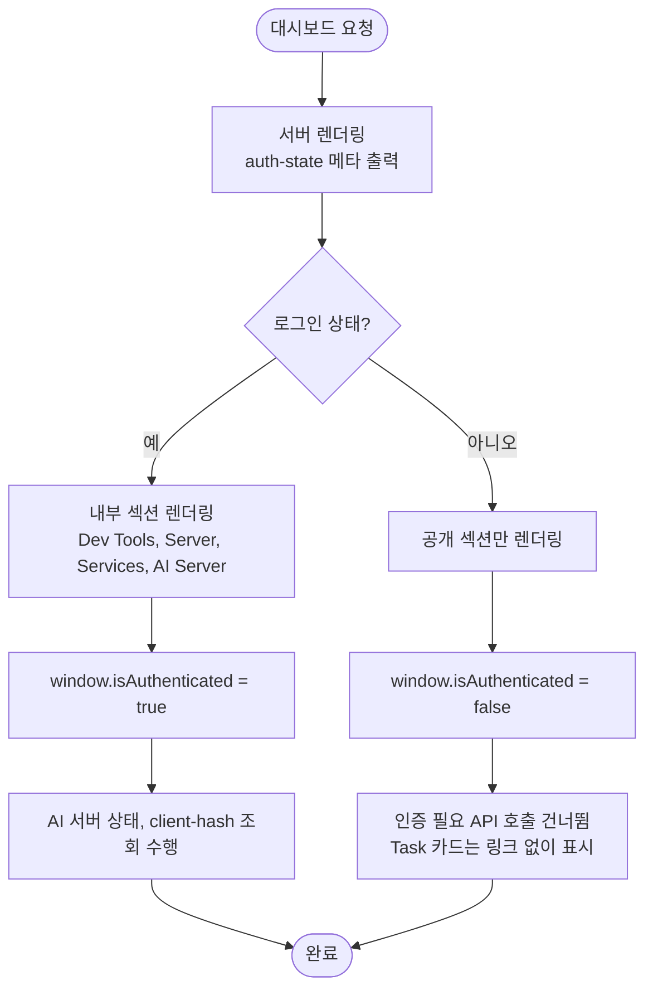

# 대시보드 전체 UI 개편 및 프로젝트 목록 정리

## 개요

대시보드가 흰 박스 나열에 하드코딩 색이 섞인 낡은 모습이었고, 라이트 모드에서 일부 글씨 대비가 낮아 흰 배경에 흰 글씨처럼 보이는 곳이 있었습니다. 전역 스타일을 DaisyUI 테마 토큰 기반으로 통일해 전체 UI를 개편했습니다. 더 이상 쓰지 않는 프로젝트를 정리하고 최신 프로젝트와 공개 도구를 Projects 섹션으로 모았습니다. 개인용 내부 도구는 맨 아래로 내렸고, 비로그인 사용자에게는 내부 섹션과 인증 API 호출이 나가지 않도록 분기했습니다. 검증 중 발견한 공지 삭제 후 목록 미갱신 버그도 함께 고쳤습니다. 배포 커밋은 `04d5a05` 입니다.

## 기능 흐름

## 변경 사항

### 삭제한 항목
- `templates/pages/dashboard.html`: Tripgether, SEJONG-MALSAMI, Mapsy, FreeMates 등 구 프로젝트 그룹, 모든 Figma 카드, Team Projects, AI Assistants(커스텀 ChatGPT) 섹션
- `docs/PROJECT_GUIDE.md`: Mapsy, 세종말싸미 안내 문장

### Projects 재구성
- `templates/pages/dashboard.html`: Projects 를 About Me 바로 아래로 이동하고 카드 13개(passQL, PickerPicker, elum, Hack the Beat, ProjectOps, ROM ROM, Re: WAVE, PLANE ACCIDENT FINDER, SUH Issue Helper, SUH Random Engine, sejong-univ-auth, Grass Planter, AI 번역기)로 구성. ROM ROM 의 접속 불가 API 링크 제거
- 개인용 내부 도구(Task D-Day, Dev Tools, Server, Services)는 맨 아래로 이동하고 AI Server 를 별도 섹션으로 분리

### 전역 스타일
- `Suh-Web/frontend/tailwind.input.css`: 라이트 테마의 success, warning, error, info 의미색을 어둡게 조정(흰 배경에서 대비 확보). primary 는 기존 값 유지
- `static/css/common.css`: Pretendard 폰트, 배경 글로우, 스크롤 진입 모션(`.reveal`, 모션 감소 설정 존중) 추가. 수동 다크 오버라이드 284개와 사용처 없는 Grass 통계 카드 규칙 제거, 공지 카드 색을 테마 변수로 교체
- `static/css/tailwind.generated.css`: 위 변경을 반영해 재생성
- `templates/fragments/header.html`, `footer.html`: 반투명 블러 헤더, 로그아웃 색 토큰화, 푸터 정리
- `sejongAuth.html`, `suhRandom.html`, `login.html`, `suhDevopsTemplate.html`, `somansaBusDashboard.html`: 하드코딩 색과 뱃지를 토큰 기반으로 정리
- `githubIssueHelper.html`: 모바일에서 안내 문구가 35px 가로로 넘치던 문제 수정

### 비로그인 처리
- `templates/fragments/header.html`: `auth-state` 메타 추가, 로그인이 필요한 메뉴 항목은 로그인 사용자에게만 표시, 공지 관리 메뉴는 슈퍼관리자에게만 표시, 비로그인 데스크탑 메뉴에 로그인 항목 추가
- `static/js/common.js`: `window.isAuthenticated` 전역 값 정의, 비로그인 시 `client-hash` 조회 생략
- `templates/pages/dashboard.html`: 내부 섹션 4개에 `sec:authorize` 적용, 비로그인 시 AI 서버 상태 조회 생략, Task 카드는 비로그인에서 링크 없이 표시

### 버그 수정
- `templates/pages/noticeManagement.html`, `dashboard.html`: 공지 삭제와 공지 댓글 삭제 API 는 204(본문 없음)로 응답하는데 `if (response)` 로 성공을 판단해, 삭제가 성공해도 "삭제 실패" 처리되고 목록이 갱신되지 않던 문제 수정

## 주요 구현 내용

- **테마 토큰 통일**: 아이콘 타일, 뱃지, 카드 색을 `primary`, `base-*` 토큰으로 바꿔 다크모드에서 자동으로 맞춰집니다. 컴포넌트별로 색을 덮어쓰지 않고 테마 값 자체를 조정한 것이 핵심입니다.
- **대비 확보**: 라이트 테마 의미색을 어둡게 해 소프트 뱃지와 텍스트의 대비를 올렸습니다.
- **비로그인 분기**: 서버에서 `sec:authorize` 로 내부 섹션을 렌더링하지 않고, 클라이언트는 `window.isAuthenticated` 로 인증 필요 API 호출을 건너뜁니다. 비로그인 상태에서 302 로 조용히 실패하던 `/api/ai-server/health`, `/api/member/client-hash` 호출이 사라졌습니다.

## 검증

- **로컬 실제 앱(dev)**
  - 13개 페이지 × 라이트/다크 × 1280px/390px, 총 52회 점검: 글자 대비, 가로 넘침, 콘솔 에러, HTTP 4xx/5xx
  - 로그인 필요 페이지 7개는 로그인 후 점검, 비로그인 상태는 공개 페이지와 보호 페이지 리다이렉트 별도 점검
  - E2E: 비로그인 보호 페이지 차단, 잘못된 비밀번호, 로그인/로그아웃, 다크 토글 유지, 언어 전환, 랜덤 닉네임 생성, Task 생성/표시/삭제, 공지 생성/대시보드 반영/삭제(슈퍼관리자), 메뉴 권한: 9/9 통과
- **프로덕션 배포 후(lab.suhsaechan.kr)**
  - CICD-BLUEGREEN 성공(빌드/이미지 푸시, Blue-Green 배포), 헬스체크 200
  - 비로그인(데스크탑, 모바일): 카드 13개, Dev Tools 숨김, 실패 요청 0, 콘솔 에러 0, 가로 넘침 0
  - 로그인: Dev Tools, AI Server 노출, 에러 0, 일반 사용자 메뉴에 공지 관리 없음, 보호 페이지 4개 200

## 주의사항

- `tailwind.generated.css` 는 빌드 산출물이라 직접 수정하지 말고 `Suh-Web/frontend` 에서 `npm run build:css` 로 재생성해야 합니다. 새 클래스를 HTML 이나 JS 에 추가한 뒤 재생성하지 않으면 누락됩니다.
- `/ai-server` 는 로컬에서 Ollama 가 없어 `models/pull/status` 가 500 을 반환합니다. 로컬 환경 문제로 보이며 이번 변경과 무관합니다.
- 공지 목록의 구분점(`·`)은 대비가 낮지만 장식용이라 그대로 뒀습니다.
- `common.css` 에는 하드코딩 색(hex)이 아직 다수 남아 있습니다. 동작에는 문제가 없었으나 추후 정리 대상입니다.
- 공개 도구 3종(SUH Issue Helper, SUH Random Engine, sejong-univ-auth)의 GitHub Pages 홍보 페이지는 각 레포 이슈(#5, #13, #16)에서 진행합니다. 완료되면 대시보드 카드 링크를 교체해야 합니다.
