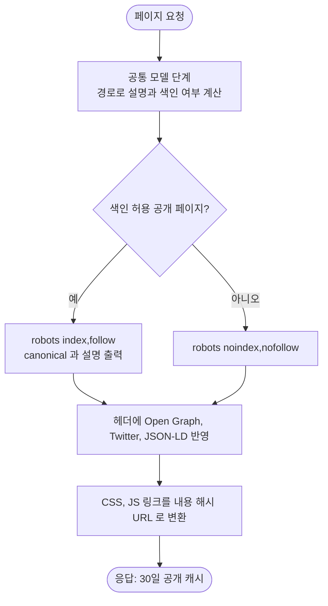

# 검색·공유 메타 정비와 프로젝트 카드 보강, 로딩 속도 개선

## 개요

공유 미리보기와 검색 노출 정보가 없던 문제를 SEO 메타로 정비하고, 프로젝트 카드를 실제 데이터로 보강했습니다. 히어로에 행동 유도 버튼을 넣었고, 정적 파일의 캐시와 해시 URL 로 로딩 속도를 개선했습니다. 배포 커밋은 `0626cb6`(SEO·카드)와 `4acfbfb`(캐시 설정 이전)입니다.

## 기능 흐름

## 변경 사항

### SEO
- `GlobalModelController`: 요청 경로로 설명(다국어), 색인 여부, canonical, 대표 이미지 주소를 계산해 모든 페이지에 제공. 오류 페이지는 색인 제외
- `templates/fragments/header.html`: description, robots, canonical, Open Graph, Twitter Card 메타와 외부 CDN preconnect 추가
- `SeoController`: `/robots.txt`(내부 경로 차단, 사이트맵 안내)와 `/sitemap.xml`(공개 페이지 6개) 제공, `PublicEndpointConfig` 에 공개 경로와 방문 집계 제외 등록
- `dashboard.html`: Person 구조화 데이터(JSON-LD), 탭 제목 변경, `<html lang>` 은 모든 페이지에 적용
- `static/images/og-image.png`: 1200×630 공유 대표 이미지
- `messages_*.properties`: 페이지 설명(ko/en)

### 프로젝트 카드와 히어로
- `dashboard.html`: 카드 8개에 대표 이미지(elum, passQL, PickerPicker 는 각 사이트의 공개 OG 이미지), 기술 스택 태그, 설명을 추가하고 문구를 다국어로 이전. 기술 스택과 설명은 레포의 언어·토픽과 사이트 설명에서 확인한 내용만 사용했고 역할과 기간은 넣지 않음
- 히어로에 "프로젝트 보기", "문의하기" 버튼과 구글 해커톤 1위 배지 추가, 비로그인에서 빈 Task D-Day 영역 숨김
- `common.css`: 스크롤 등장 애니메이션이 완전 투명에서 시작하지 않도록 완화

### 로딩 속도
- `WebConfig`: CSS·JS 에 내용 해시 URL 과 30일 공개 캐시, 이미지에 7일 공개 캐시를 적용하고 `ResourceUrlEncodingFilter` 로 템플릿 링크를 해시 URL 로 변환

## 주요 구현 내용

- 20여 개 페이지의 호출부를 바꾸지 않도록, 헤더가 읽는 값을 공통 `ControllerAdvice` 한 곳에서 계산했습니다.
- 캐시 설정은 처음에 `application.yml` 에 넣었으나, 배포 워크플로우가 이 파일을 시크릿으로 덮어써서 프로덕션에는 적용되지 않았습니다. 배포 후 응답 헤더로 이를 발견해 Java 설정(`WebConfig`)으로 옮겼습니다. 서버 압축 설정은 Cloudflare 가 이미 압축(br)하고 있어 제거했습니다.

## 검증

- 로컬: 점검 52회에서 대비, 가로 넘침, 콘솔 에러, 실패 요청 0건, 문구 누락 0건(26개 화면), 메타와 JSON-LD 와 `robots.txt` 와 `sitemap.xml` 확인, 권한·CRUD E2E 통과(생성 직후 목록 갱신 확인에서 응답 지연으로 1회 일시 실패했으나 측정상 1.8초 후 정상 반영)
- 프로덕션 배포 후: CICD-BLUEGREEN 성공, 헬스체크 200, 해시 URL 적용, `Cache-Control: public, max-age=2592000`, Cloudflare 캐시 MISS 후 HIT 확인, CSS 가 br 압축으로 약 23KB, 13개 페이지 × 1280px/390px 26회 점검 모두 정상

## 주의사항

- 배포의 `application.yml` 은 시크릿(`APPLICATION_YML`)으로 주입되므로 저장소 yml 변경은 프로덕션에 반영되지 않습니다. 새 설정은 코드나 시크릿 중 어디에 둘지 먼저 정하세요.
- 기준 도메인은 `site.base-url` 설정으로 바꿀 수 있고 기본값은 `https://lab.suhsaechan.kr` 입니다.
- 정적 파일은 30일 캐시되므로 CSS·JS 는 반드시 템플릿의 `th:href`, `th:src` 로 참조해야 배포 시 갱신됩니다. 하드코딩한 경로는 오래된 파일이 남을 수 있습니다.
- 공유 미리보기와 검색 색인 반영은 외부 도구(카카오톡·페이스북 공유 디버거, 구글 서치콘솔)에서 확인해야 정확합니다.
- 프로젝트 카드의 역할과 기간, 서버 응답 속도(CSS 첫 요청 약 0.4~0.9초)는 이번 범위 밖입니다.
