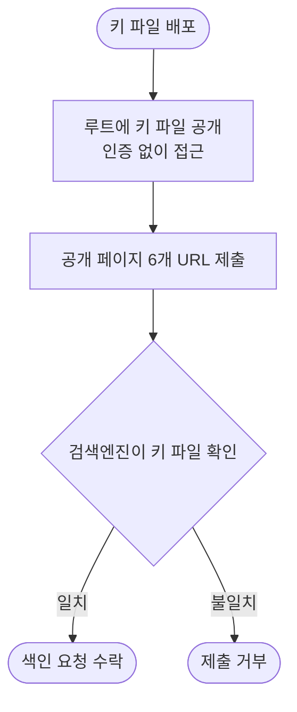

# IndexNow 로 Bing, Naver 에 공개 페이지 색인 요청

## 개요

새로 정비한 SEO 메타와 사이트맵을 검색엔진이 더 빨리 반영하도록, 계정 없이 쓸 수 있는 IndexNow 프로토콜을 적용했습니다. 사이트 루트에 키 파일을 올려 소유를 증명하고 공개 페이지 6개의 URL 을 제출했습니다. 배포 커밋은 `51a6461` 입니다.

## 기능 흐름

## 변경 사항

- `static/<키>.txt`: IndexNow 소유 확인 키 파일(32자리, 파일 내용이 키와 같음)
- `PublicEndpointConfig`: 키 파일 경로를 인증 없이 접근 가능한 공개 경로로 등록하고 방문 집계에서 제외

## 검증

- 로컬: 키 파일이 비로그인으로 200 이고 내용이 일치하며, 보호 페이지는 여전히 302 로 막혀 있음
- 프로덕션 배포 후: 키 파일 200, 내용 일치
- 제출한 URL: 대시보드, 이슈 헬퍼, 번역기, 세종대 인증, SUH 랜덤, DevOps 템플릿
- 제출 응답: IndexNow 엔드포인트 202, Bing 202, Naver 200

## 주의사항

- IndexNow 는 Bing, Naver, Yandex 등이 지원하며 **구글은 지원하지 않습니다.** 구글은 서치콘솔에서 사이트맵을 제출해야 합니다(사용자 계정 필요).
- 응답 코드는 "요청 수락"을 뜻하며 색인 완료를 보장하지 않습니다. 반영까지는 시간이 걸립니다.
- 키는 공개되도록 설계된 값입니다. 키 파일을 지우거나 바꾸면 이후 제출이 거부됩니다.
- 페이지를 크게 바꾸거나 새 공개 페이지를 추가하면 같은 방식으로 URL 을 다시 제출하세요.
