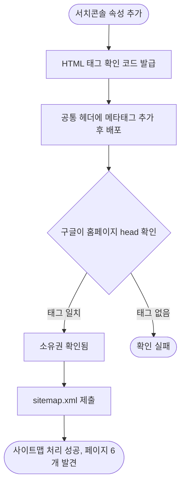

# 구글 서치콘솔 소유 확인 메타태그 추가와 사이트맵 제출

## 개요

lab.suhsaechan.kr 을 구글 서치콘솔에 URL 접두어 속성(`https://lab.suhsaechan.kr/`)으로 등록하고, HTML 태그 방식으로 소유를 확인한 뒤 사이트맵을 제출했습니다. 배포 커밋은 `d3759e0` 입니다.

## 기능 흐름

## 변경 사항

- `fragments/header.html`: `google-site-verification` 메타태그를 canonical 링크 아래에 추가. 공통 head fragment 라 모든 페이지에 노출됨

## 검증

- 프로덕션 배포 후 홈페이지 HTML 에 메타태그가 그대로 노출됨(`curl` 확인)
- 서치콘솔 소유권 확인: "소유권이 확인됨", 확인 방법 HTML 태그
- 사이트맵: `/sitemap.xml` 제출, 상태 "성공", 발견된 페이지 6개

## 주의사항

- 메타태그를 지우면 소유권이 풀립니다. 헤더를 정리할 때 이 줄은 남겨 두세요.
- 색인 생성과 검색 실적 데이터는 구글이 크롤링한 뒤 며칠에 걸쳐 쌓입니다.
- 도메인 속성(`suhsaechan.kr`)은 등록되어 있지 않습니다. 다른 하위 도메인까지 한 번에 보려면 DNS TXT 레코드로 도메인 속성을 추가해야 합니다.
