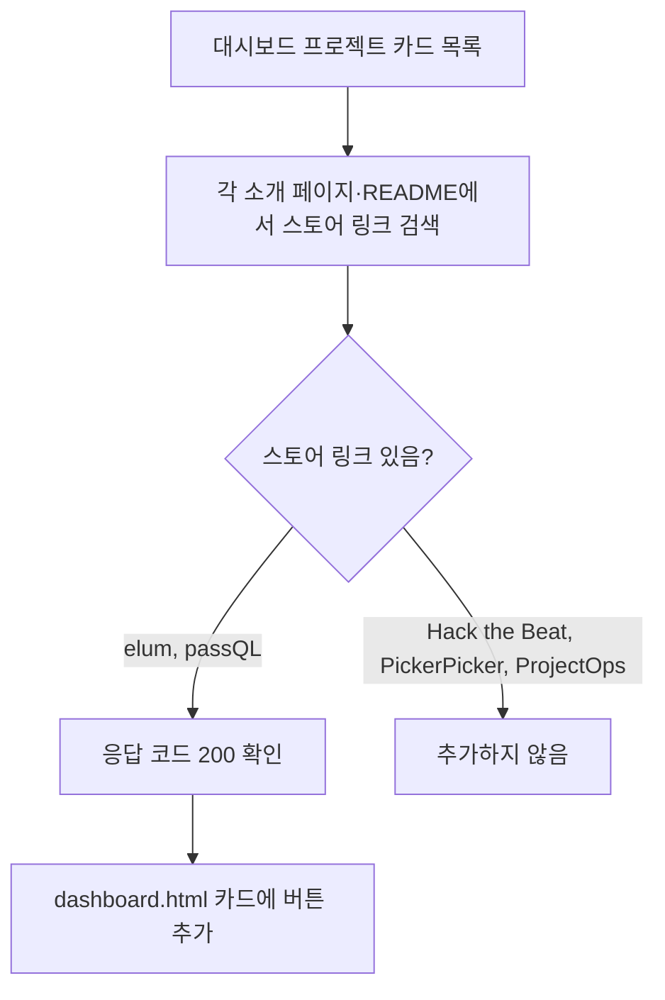

<!-- projectops:report -->
# Dashboard 프로젝트 카드 스토어 링크 업데이트

## 개요

대시보드 Projects 카드 중 앱스토어·플레이스토어에 출시된 앱의 스토어 바로가기를 채웠다.
ROM ROM의 Google Play·App Store 링크와 APK 카드 제거는 이전 대시보드 작업에서 이미 반영돼 있었다. 이번에는 그 뒤 출시된 elum·passQL의 스토어 링크와, 이슈 본문에 있던 ROM ROM 팀 GitHub 링크를 추가했다.

## 변경 사항

`Suh-Web/src/main/resources/templates/pages/dashboard.html` (12줄 추가)

| 카드 | 추가한 버튼 | 링크 |
|---|---|---|
| elum | Google Play | `play.google.com/store/apps/details?id=kr.twinfang.elum` |
| elum | App Store | `apps.apple.com/kr/app/id6792970508` |
| passQL | App Store | `apps.apple.com/kr/app/id6762165005` |
| ROM ROM | GitHub | `github.com/TEAM-ROMROM` |

- 버튼 순서는 EarLocAlert 카드와 같게 맞췄다: 소개 페이지 > (웹사이트) > Google Play > App Store > GitHub
- 버튼 마크업은 기존 카드와 같은 DaisyUI 클래스(`btn btn-sm btn-soft btn-primary`)와 Font Awesome 아이콘(`fa-google-play`, `fa-apple`, `fa-github`)을 그대로 썼다. 새 클래스가 없어서 `tailwind.generated.css`를 다시 빌드할 필요가 없다.

## 링크 수집 근거

스토어 링크는 추측하지 않고 각 프로젝트의 공개 자료에서 찾았다.

- elum: `twin-fang.github.io/elum` 소개 페이지와 README에서 iOS·Android 링크를 찾았다
- passQL: 소개 페이지와 README에서 iOS 링크만 찾았다. Android 출시 링크는 없다
- Hack the Beat, PickerPicker, ProjectOps: 스토어 링크가 없어 손대지 않았다

## 검증

- 스토어·GitHub 링크 4개가 모두 HTTP 200으로 열리는 것을 확인했다
- `dashboard.html`의 `<a>`·`
`·`<article>` 태그 짝이 맞는 것을 확인했다
- 배포: deploy PR #274 자동 머지, BLUEGREEN 배포 워크플로(빌드 & 이미지 Push, Blue-Green 배포) 성공
- 운영 `https://lab.suhsaechan.kr/` 응답 HTML에 새 링크 4개가 모두 나오는 것을 확인했다

## 주의 사항

- 스토어 링크는 `dashboard.html` 한 곳에만 있다(다른 템플릿·JS·문서에 사본 없음). 새 앱이 출시되면 이 파일의 해당 카드만 고치면 된다
- passQL이 Android로 출시되면 Google Play 버튼을 App Store 버튼 앞에 추가하면 된다
