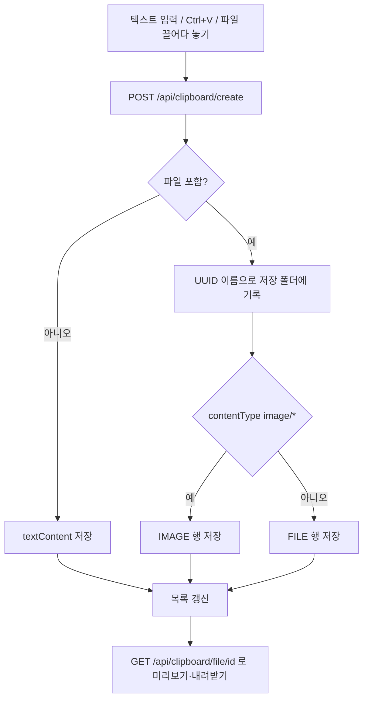

<!-- projectops:report -->
# 웹 클립보드 기능 추가

## 개요

망분리 환경에서는 PC끼리 클립보드를 주고받을 수 없다. 로그인한 사용자만 쓰는 `/clipboard` 페이지를 만들어 텍스트·이미지·파일을 웹에 올리고 다른 PC에서 복사하거나 내려받게 했다.

## 변경 사항

| 구분 | 내용 |
|---|---|
| 새 모듈 | `Suh-Domain-Clipboard`: `ClipboardItem` 엔티티, `ClipboardItemRepository`, `ClipboardService`, DTO 4개 |
| 공통 | `ClipboardItemType`(TEXT·IMAGE·FILE), `ErrorCode`에 클립보드 오류 3개 |
| API | `ClipboardController`: `POST /api/clipboard/create·list·delete`, `GET /api/clipboard/file/{id}` |
| 화면 | `pages/clipboard.html`, `static/js/clipboard.js`, 대시보드 도구 카드, 문구 i18n |
| DB | Flyway `V2_5_115__create_clipboard_item.sql` (`CREATE TABLE IF NOT EXISTS`) |
| 규칙 | 아키텍처 규칙 파일 `paths=`에 새 모듈 추가 |

올리는 방법은 3가지다: 텍스트 입력 후 저장, 페이지에서 Ctrl+V(텍스트·이미지·파일), 파일 끌어다 놓기·선택.

## 왜 이렇게 했나

- **파일을 `/uploads/**`에 두지 않음**: 그 경로는 로그인 없이 열린다. 클립보드 파일은 `/mnt/suh-project-utility/clipboard`에 두고, 로그인이 필요한 API로만 내보낸다.
- **저장 파일명은 UUID**: 사용자가 준 파일명은 DB에만 남긴다. 경로 이동 공격을 막기 위해 저장 폴더 밖 경로도 거부한다.
- **파일 응답 헤더**: `X-Content-Type-Options: nosniff`, `Content-Security-Policy: sandbox`. 올린 HTML·SVG가 사이트 권한으로 실행되지 않게 한다.
- **저장 실패 시 DB 행을 남기지 않음**: 파일 없이 목록에만 남는 항목을 막는다.

## 하지 않은 것

여러 사용자 간 권한 구분(로그인 사용자 전체가 같은 목록), 자동 만료·용량 정리, HTML 서식 보존, 실시간 동기화.

## 검증

- `ClipboardServiceTest` 4개 통과, 아키텍처 규칙 테스트 통과
- 배포: deploy PR #275 자동 머지, Blue-Green 배포 성공
- 운영 확인
  - `/clipboard`, `/api/clipboard/*`는 로그인하지 않으면 로그인 화면으로 이동(302)
  - DB: `flyway_schema_history`에 2.5.115 성공 기록, `clipboard_item` 테이블 생성 확인
  - 컨테이너 안에서 `/mnt/suh-project-utility/clipboard`에 테스트 파일을 만들고 지우는 데 성공 (쓰기 가능)
- 로그인 후 실제 업로드·복사는 직접 해보지 않았다

## 주의 사항

- 저장 경로는 `clipboard.storage-dir`(기본 `/mnt/suh-project-utility/clipboard`)이다. 컨테이너 볼륨 마운트가 바뀌면 재배포 때 파일이 사라질 수 있다.
- 자동 정리가 없어 파일이 계속 쌓인다. 용량이 문제가 되면 항목을 지우거나 만료 기능을 따로 추가해야 한다.
