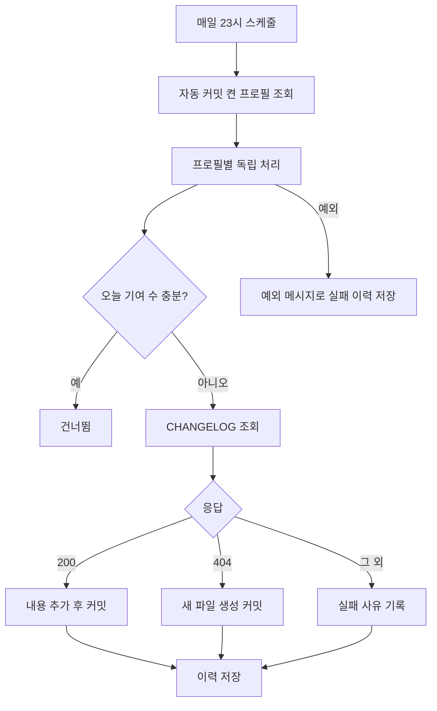

<!-- projectops:report -->
# 잔디심기 실패 사유 기록과 서비스 분리

## 개요

#62의 원래 요구(별도 서버 없이 이 프로젝트 안에서 잔디심기 실행·이력·제어 관리)는 `Suh-Domain-GrassPlanter`로 이미 들어와 있었다. 남은 문제는 두 가지였다. 커밋이 실패해도 이유를 알 수 없었고, `GrassService` 한 파일(558줄)에 책임이 몰려 있었다.

## 변경 사항

| 구분 | 내용 |
|---|---|
| 분리 | `GrassService`(558줄) 삭제 > `GrassProfileService`(프로필), `GrassGithubClient`(GitHub API·응답 파싱), `GrassCommitService`(수동·자동 커밋, 이력) |
| 결과 DTO | `GrassCommitResult`: 성공 여부와 실패 사유 |
| 저장소 | `GrassProfileRepository.findAutoCommitEnabledWithRepository()`: 기본 저장소를 fetch join으로 함께 조회 |
| 화면 | `grassPlanter.html` 실패 이력 행 아래에 실패 사유 표시 |
| 호출부 | `GrassController`, `PageController` 새 서비스로 교체 |
| 테스트 | `GrassCommitServiceTest` 5개, `GrassGithubClientParseTest` 6개(기존 파싱 테스트 이동) |

## 왜 이렇게 했나

- **실패 사유를 결과에 담음**: 예전에는 커밋 메서드가 `boolean`만 돌려줘서 이력의 `errorMessage`가 비어 있었다. 이제 기본 저장소 없음, 조회·PUT 실패 상태 코드, 예외 메시지가 남는다. 사유는 컬럼 길이에 맞춰 1000자로 자른다.
- **자동 커밋에서 메서드 전체 트랜잭션 제거**: 한 프로필의 DB 오류가 다른 프로필 이력까지 롤백시킬 수 있었다. 프로필마다 독립 저장하고, 예외가 나도 실패 이력 1건을 남긴다.
- **자동 커밋도 프로필 커밋 메시지 템플릿 사용**: 예전에는 고정 문구만 썼다. 템플릿이 비어 있으면 기존 문구 `Auto-commit: Daily contribution`을 쓴다.
- **fetch join**: 스케줄러는 트랜잭션 밖에서 돌기 때문에 지연 로딩한 기본 저장소를 읽다가 오류가 날 수 있었다.

## 동작 변경

CHANGELOG 조회가 실패했을 때, 예전에는 어떤 오류든 새 파일을 만들어 커밋을 시도했다. 지금은 **파일이 없을 때(404)만** 새로 만들고, 권한 오류나 서버 오류는 실패 사유와 함께 이력에 남긴다. 기존 CHANGELOG를 덮어쓰는 위험을 없애기 위해서다.

## 하지 않은 것

실패 메일 알림, 스케줄 시각 변경, 화면 개편, DB 스키마 변경(기존 `error_message` 컬럼 사용).

## 검증

- `GrassCommitServiceTest` 5개, `GrassGithubClientParseTest` 6개 통과, 아키텍처 규칙 테스트·`Suh-Web` 컴파일 통과
- 배포: deploy PR #277 자동 머지, Blue-Green 배포 성공(새 컨테이너가 상태 확인을 통과해 교체됨)
- 운영 확인: `/grass`는 로그인하지 않으면 로그인 화면으로 이동(302), 대시보드 200
- 자동 커밋은 매일 23시에 돌아서 오늘 밤 실행에서 처음 확인된다. 아직 실제 자동 커밋 결과는 보지 않았다

## 주의 사항

- 자동 커밋 메서드에 다시 `@Transactional`을 붙이면 프로필 독립 저장이 깨진다.
- 스케줄러에서 프로필의 다른 연관 엔티티를 새로 읽게 되면, 그것도 fetch join 조회에 넣어야 한다.
